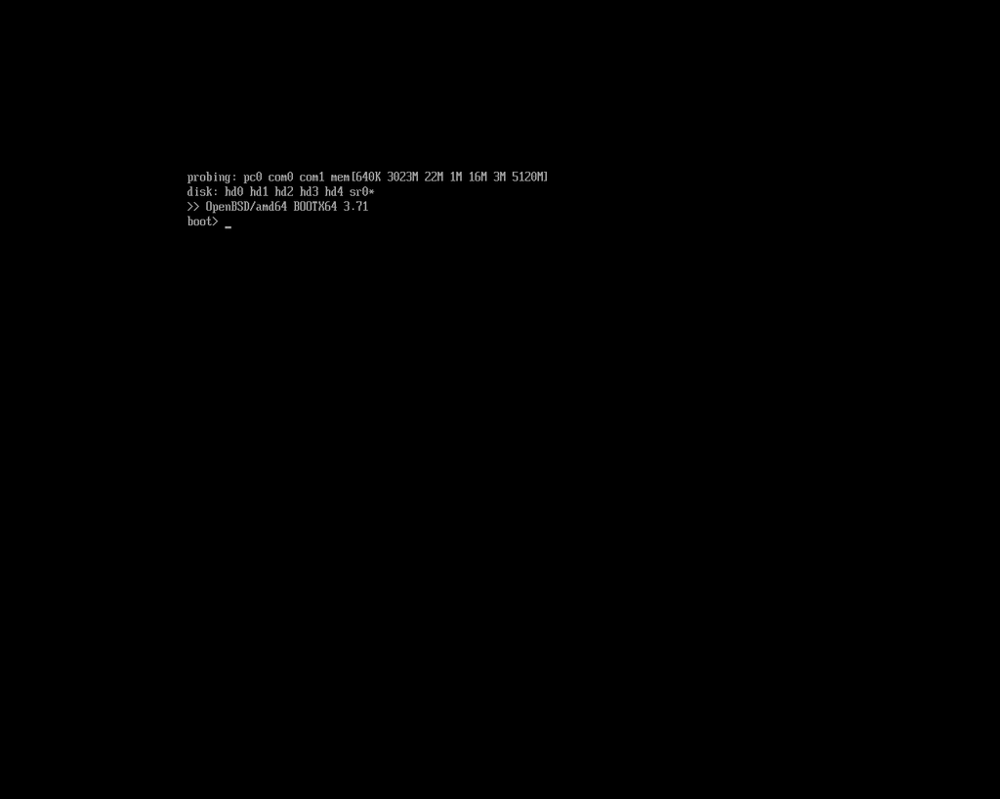
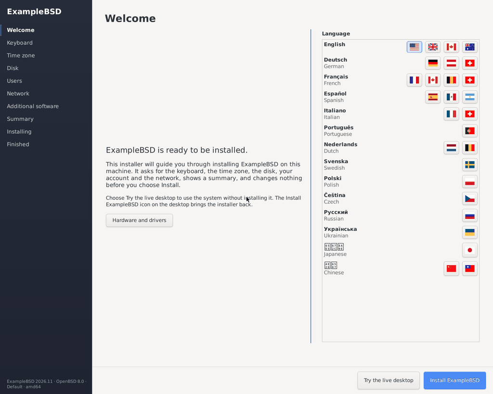
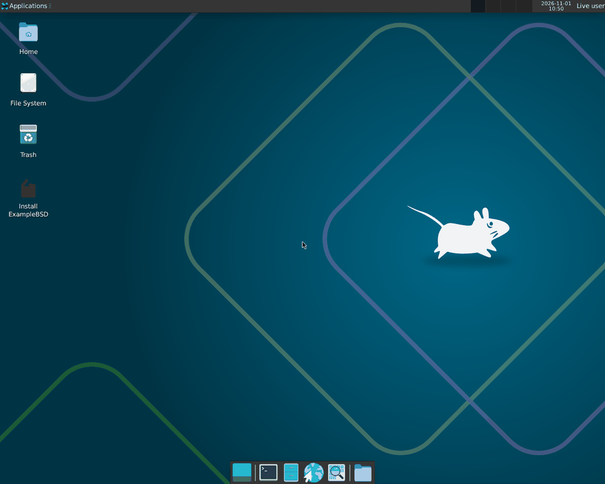
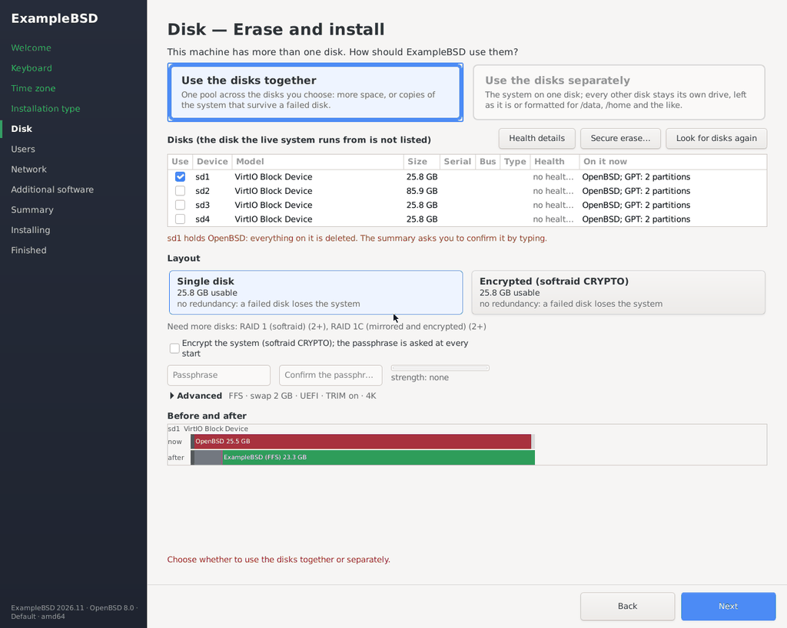
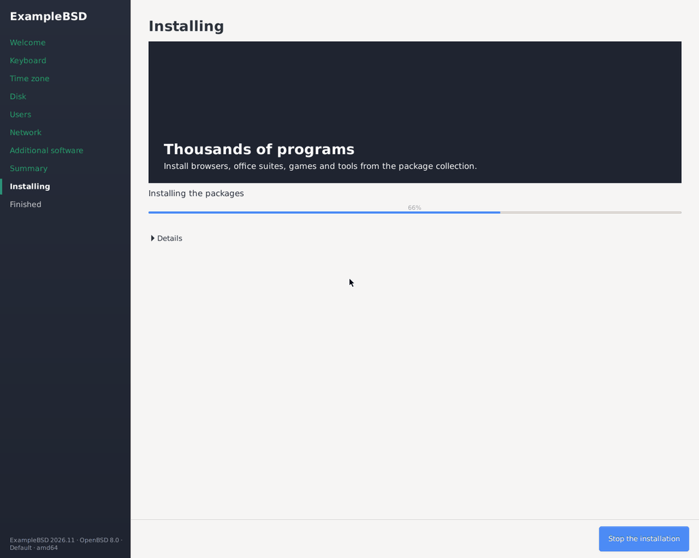
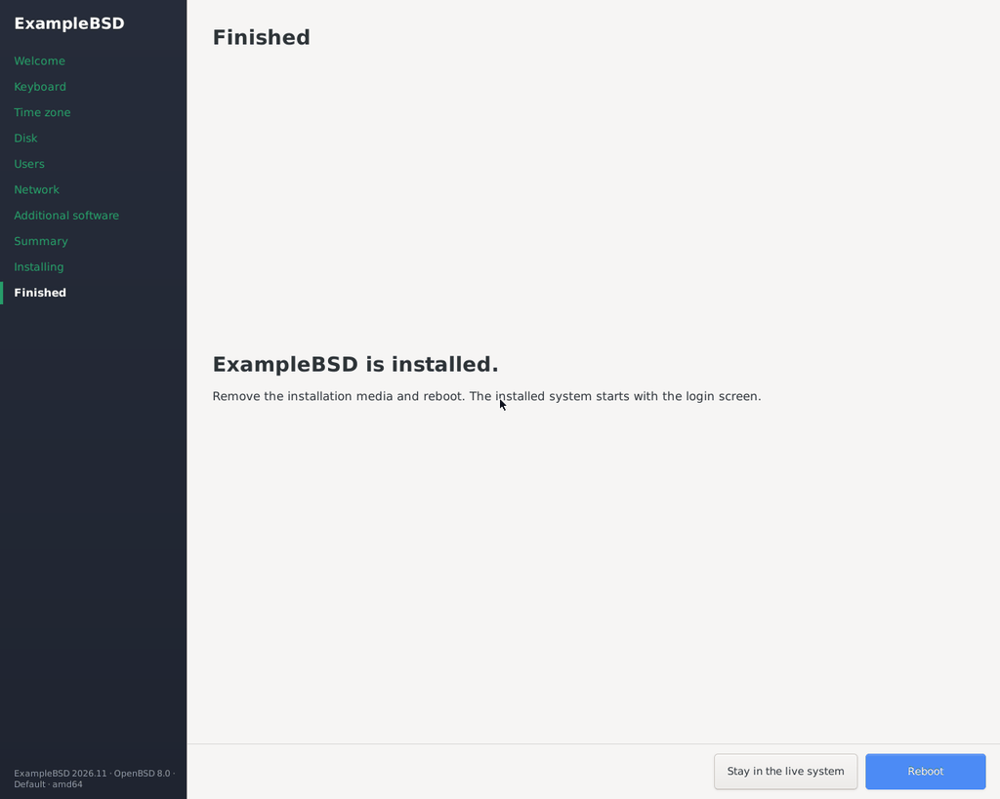
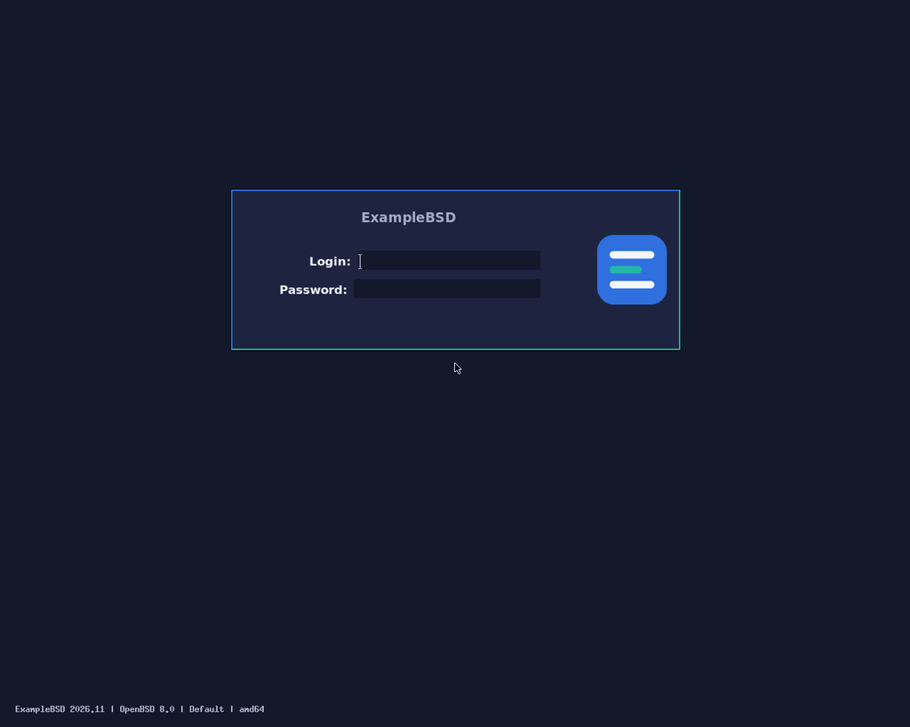
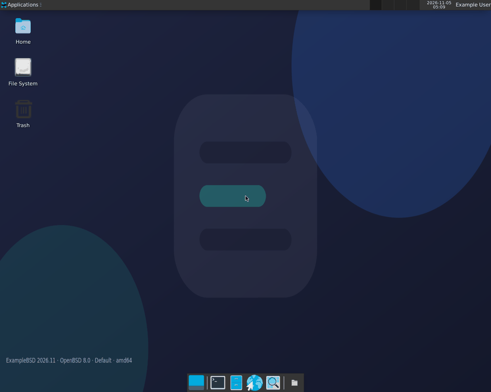

# openbsd-template — OpenBSD distribution template

A template for shipping a per-product distribution that is an **overlay on
unmodified upstream OpenBSD**. Product name placeholders: **ExampleBSD**
(slug `examplebsd`). The template never patches the OpenBSD source tree
and never patches the ports tree: it ships a *site set*, the mechanism
OpenBSD has for exactly this.

- A site set is a gzip(1) compressed tar(1) archive named
  `site${VERSION}.tgz` — `site80.tgz` for release 8.0 — rooted in `/`. The
  installer unpacks it over the new root and then runs the executable
  `/install.site` inside it, in a chroot(8) based at the new root
  (`install.site(5)`).
- An unattended install is driven by `autoinstall(8)` with a response file
  (`install.conf`, one `question = answer` line per question).
- The base system itself is built with `release(8)`, and only on OpenBSD:
  OpenBSD has no cross build.

License: BSD-2-Clause (see `LICENSE`).

## What it looks like

The live image of the desktop, ExampleBSD on **OpenBSD 8.0** (amd64), on a
virtual machine (bhyve, UEFI, 1280x1024), driven with the keyboard alone (see
[The pointer under bhyve](#the-pointer-under-bhyve)); the boot prompt took
its commands on the serial console.

The boot loader of OpenBSD 8.0 (it has no splash screen), stopped at its
prompt:



The live system logs the live user in and opens the installer first,
full screen, with the identity line in its lower left corner:



"Try the live desktop" closes it into Xfce; the "Install ExampleBSD" icon
and the menu entry open it again:



The disk page: the disks OpenBSD detects (fdisk, disklabel, bioctl; the
live disk is not listed), the layouts this template offers (single disk,
softraid CRYPTO; RAID 1 and RAID 1C with two disks or more) and the plan
before and after. Here the live image runs from the third disk, sd2: it
wrote `/dev/sd2` into `/var/run/wtfbsd-live-medium` (see
[The live image (desktop)](#the-live-image-desktop)) and the page lists
sd0, sd1, sd3 and sd4 only. The disks are used separately:

- sd0 holds the system.
- sd1 is formatted as a drive on /data. /etc/fstab names it by its disk
  ID (DUID), so it still mounts when the disks come up in another order.
- sd3 and sd4 are left as they are.




Installing (the install command reports its progress to the installer):





The installed system (OpenBSD 8.0) shows the greeter of xenodm(1) with the
branding of the artwork template: the product's logo and name (no Puffy),
its colours, and the identity line lower left; no automatic login:



The account created in the installer, logged in to Xfce, on the wallpaper
of the artwork template stamped with the identity line (lower left):



## Layout

```
:.
├── AGENTS.md                 the short contract for an agent working here
├── Jenkinsfile               CI: validate, build the site set, boot test, archive
├── build.sh                  the build driver (POSIX sh)
├── opencode.json             the agents of this repository
├── autoinstall/
│   └── install.conf.template autoinstall(8) response file template
├── ci/
│   ├── media.sh              put the site set and the response file into the
│   │                         stock install media (an ISO9660 image)
│   ├── vm.sh                 THE VM front door: create/console/addr/destroy
│   └── providers/
│       └── bhyve.sh          the one reference provider (stock bhyve(8))
├── overlay/                  THE overlay: nothing here patches the base system
│   ├── base/
│   │   ├── packages.list     packages every install gets
│   │   └── rootfs/
│   │       ├── etc/motd.template   becomes the live /etc/motd
│   │       ├── etc/rc.conf.local   the base daemon configuration
│   │       └── install.site        what the installer runs at the end
│   └── profiles/
│       ├── appliance/        headless: serial console, key-only sshd
│       │   ├── packages.list
│       │   └── rootfs/{etc/doas.conf,etc/rc.conf.local,etc/ssh/sshd_config}
│       └── desktop/          X11 only: Xenocara + xenodm(1) + xfce
│           ├── packages.list
│           └── rootfs/{etc/doas.conf,etc/rc.conf.local,etc/skel/.xsession,
│                        etc/skel/.xinitrc}
└── tests/
    ├── boot-test.sh          boot an image in a VM and wait for a login
    ├── run-tests.sh          the test suite (no root, no network, no VM)
    └── fixtures/             product.conf, answers and a fake VM provider
```

## Overlay rules

- **The base system is never patched.** The overlay is turned into a site
  set, and the installer unpacks that over the new root.
- `@DISTRO_NAME@`, `@MOTD@`, `@SLUG@` and `@BRAND_URL@` placeholders in the
  overlay files are substituted by `build.sh` from `product.conf`.
- A staged path with a literal `@SLUG@` in it is renamed to the slug
  (`usr/local/share/@SLUG@/packages.list` becomes
  `usr/local/share/examplebsd/packages.list`).
- `overlay/base/rootfs/etc/motd.template` becomes the live `/etc/motd`:
  OpenBSD has no `rc.d/motd` that would regenerate it.
- **One `rc.conf.local` per root.** OpenBSD has no `rc.conf.d`: the base
  file is `overlay/base/rootfs/etc/rc.conf.local`, and the file a profile
  ships under `rootfs/etc/rc.conf.local` is a *fragment* that `build.sh`
  appends to the base file. The base settings live in the base file, the
  profile settings in the fragment.
- A daemon is enabled the OpenBSD way: `rc.conf(8)` reads
  `/etc/rc.conf.local`, and `<daemon>_flags=` (empty) runs the daemon with
  its default arguments while `<daemon>_flags=NO` disables it. Package
  daemons are listed in `pkg_scripts`.
- The site set is archived with the owner `0:0` and a fixed modification
  time, so two builds of the same input produce the same file.
- The archive holds a **file list only**: it has no entry for `.` and none
  for a directory. The installer unpacks the archive over the new root, and
  a directory entry would hand the mode and the owner of the staged
  directory to `/etc`, `/usr` and the rest of that root. The `tar(1)` of
  OpenBSD has no owner override at all, so **on OpenBSD the build refuses
  to run as a user other than root**: the members would otherwise keep the
  uid of the builder. Build the site set on a FreeBSD or Linux node (the
  `AGENT_LABEL` of the Build stage); only the Media stage needs OpenBSD.
- The list of the files is spelled the way the `tar(1)` of the host reads
  it: `-I` on OpenBSD, `-T` with the GNU tar and the bsdtar. The build
  picks the flavour of the host itself and never guesses.
- Any `rm -rf` in `build.sh` is guarded: only paths that are validated
  non-empty and under the output directory may be removed.

## The no-ZFS rule

OpenBSD has no ZFS at all: **FFS is the only filesystem choice**. The build
refuses `FILESYSTEM_ROOT=zfs` and `ZFS_DATA_POOL=yes` with exactly that
sentence. There is no way to talk this template into a ZFS root.

## The mt76 rule

The mt76 wireless driver is **never enabled, loaded or configured** by this
template. `build.sh` enforces this: the build fails if any file under
`overlay/` even mentions mt76 — which is why the overlay contains no such
mention at all. Keep it that way.

## Profiles

| profile     | what it builds |
|-------------|----------------|
| `appliance` | headless: the serial console is the system console, `sshd` runs with its default arguments and only accepts keys (`PermitRootLogin no`, `PasswordAuthentication no`), no extra packages. |
| `desktop`   | X11 only: the base Xenocara plus the `xfce` package, the X server is started by `xenodm(1)` (`xenodm_flags=` in the fragment of the profile) and the session of a new account is the Xfce session (`/etc/skel/.xsession` and `/etc/skel/.xinitrc`). **No Wayland anywhere and no display manager** (no LightDM). `sshd` is disabled on purpose (`sshd_flags=NO`): OpenBSD starts it by default. The desktop also builds the live set and the live image (see [The live image](#the-live-image-desktop)). |

The appliance ships no `/etc/boot.conf`: the installer writes the
`stty com0 115200` and `set tty com0` lines of `boot.conf(8)` itself,
when the response file answers `Change the default console to com0 = yes`.

## Building

Needs `product.conf` in the format of wtfbsd/agents
`scripts/apply-answers.sh` (the full key list is `KNOWN_KEYS` in
`build.sh`, mirroring wtfbsd/agents `questions.yaml`). `product.conf` is
parsed, never sourced. The build refuses any `DISTRO_OS` other than
`openbsd` and validates the slug against `^[a-z][a-z0-9-]*$`.

```sh
./build.sh -c product.conf -n                        # dry run: print the plan, write nothing
./build.sh -c product.conf -r 8.0 -u operator -k operator.pub
./build.sh -c product.conf -r 8.0 -p both -u operator -k operator.pub
```

| option | meaning |
|--------|---------|
| `-c`   | product.conf (required) |
| `-r`   | the OpenBSD release, `N.N` (default 8.0). The site set is named after it without the dot: `site80.tgz` |
| `-o`   | output directory (default `./out`) |
| `-p`   | `desktop`, `appliance` or `both` (default: the `PROFILE` of `product.conf`) |
| `-u`   | the name of the operator account the installer creates (`^[a-z_][a-z0-9_-]{0,31}$`) — **required** |
| `-k`   | a file with the SSH public key of that account (one key) — **required** |
| `-P`   | a file with the bcrypt hash of the password of that account — **required by the `desktop` profile**, optional for the `appliance` |
| `-n`   | dry run |

### The login path

The site set is **key-only**: the `sshd_config` of the appliance refuses
password logins and the root password is locked. The operator account and
its public key are therefore **required inputs** of the build:

- `-k PUBKEYFILE` names a file with one SSH public key (the type and the key
  material; the comment of the line is dropped). The first field of the line
  is the type, and it has to be exactly one of the ones an `authorized_keys`
  file takes: `ssh-ed25519`, `ssh-rsa`, `ecdsa-sha2-nistp256/384/521` and the
  two `sk-` types with their `@openssh.com` domain. A type that is only the
  beginning of one of them (`ssh-ed25519x`, say) is not a key type. A file
  with no key, with a key of another type or with more than one key is
  refused, and the refusal names the check and the file, never the contents
  of the file.
- `-u USER` names the account the installer creates. It has to be a user
  name: lowercase, starting with a letter or an underscore, at most 32
  characters.

A build without them is **refused**; a dry run (`-n`) reports the missing
input instead and writes nothing. The two answers go into the response file:

```
Setup a user = operator
Public ssh key for user = ssh-ed25519 <the key material of the file>
```

### The password of the operator account

A key is not a way in for everybody: the **desktop** has no `sshd` at all
(`sshd_flags=NO` in the fragment of the profile), so the console is the
only way in, and a console without a password is a console nobody can
use. The password is therefore a **required input of the desktop**:

- `-P HASHFILE` names a file with one bcrypt hash (`$2a$`, `$2b$` or
  `$2y$`, the cost, and 53 characters). A file with no hash, with more
  than one hash or with a hash that is not a bcrypt hash is refused.
- The hash is **read from the file**. It is never an argument of
  `build.sh` (an argument of a command is in the list of processes of
  every user of the machine), and it is **never printed**: not in the
  plan of the build, and not in the message of a refusal.
- For the **appliance** the option is optional: its `sshd` refuses the
  password logins, so the response file holds the 13 asterisks that
  disable them and keep the installer from stopping on the question.

A desktop build without `-P` is **refused**; a dry run (`-n`) reports the
missing input instead and writes nothing. The answer goes into the
response file:

```
Password for user = <the bcrypt hash of the file>
```

The wording of that answer is **unverified**: `autoinstall(8)` does not
document it. `install.sub(8)` asks "Password for user *\<name\>*?", and
the key above is the part of the question that does not carry the name of
the account. Check it against the installer of the target release before
you rely on it.

### The operator account becomes root

The operator account is a member of the group `wheel`, and
`doas.conf(5)` grants the members of that group the right to become root:

| profile | rule | why |
|---------|------|-----|
| `appliance` | `permit nopass :wheel` | the appliance is key-only: its password is never typed, so the rule may not ask for one |
| `desktop` | `permit persist :wheel` | the desktop has a password, so `doas(1)` asks for it; "persist" keeps the credentials for a while |

`autoinstall(8)` does not ask for the groups of the account it creates, so
the membership is made by `install.site`, which runs
`usermod -G wheel` on the account at the end of the install. A `usermod`
that fails is not hidden: the failure is written in
`/etc/examplebsd-wheel-failed`, the message of the day warns about it,
the packages are still installed, and `install.site` exits non-zero at the
end. The two
`doas.conf` files are shipped with the mode **0600** and the owner
**root:wheel** (`0:0`): the rules of `doas(1)` are read by root and by
nobody else.

Environment knobs:

| variable | meaning |
|----------|---------|
| `WTFBSD_BUILD_BASE=yes` | also build the base system with `release(8)`. OpenBSD hosts only: the build refuses this path on any other host with a clear message |
| `WTFBSD_SRC` | the unmodified OpenBSD source tree (default `/usr/src`) |

Artifacts:

```
out/site80.tgz            the site set (install.site(5))
out/install.conf          the autoinstall(8) response file, mode 0600
out/install.conf.redacted the same file with the password redacted
out/SHA256                the checksums of the site set and of the
                          redacted response file
```

With `-p both` the artifacts land in `out/appliance/` and `out/desktop/`,
one directory per profile, each with the same four files.

The response file holds the hash of the password of the operator account:
it is a secret. It is written with the mode **0600**, and `build.sh`
writes a redacted copy next to it, with the value of
`Password for user` replaced by `<redacted>`. The CI archives the redacted
copy and never the response file itself: an archived artifact must not
carry a secret.

The site set holds:

```
install.site                                    run by the installer at the end
etc/motd                                        the message of the day
etc/myname                                      the name of the host (OpenBSD)
etc/rc.conf.local                               the daemon configuration
etc/doas.conf                                   the rules of doas(1), mode 0600
etc/ssh/sshd_config                             appliance only
etc/skel/.xsession                              desktop only
usr/local/share/examplebsd/packages.list        the packages to install
```

## Unattended install

`autoinstall(8)` reads a response file of `question = answer` lines. The
template is `autoinstall/install.conf.template`; `build.sh` substitutes the
placeholders, strips the comment lines and writes `out/install.conf`.

The template holds directives, and they are checked while it is read:

| directive | meaning | refused when |
|-----------|---------|--------------|
| `#@if MODE` | the answers of the block are kept when the mode of the build is `MODE` (`NET_STATIC`, `NET_DHCP`) | it is inside another `#@if` (a nested `#@if`), or the block is never closed (no `#@endif`) |
| `#@else` | the other half of the block | it is outside an `#@if`, or there is a second `#@else` in the same `#@if` |
| `#@endif` | the end of the block | there is no open `#@if` |
| `#@profile NAME` | the answers of the block are kept for the profile `NAME` | there is an open `#@profile`, or an open `#@if` |
| `#@endprofile` | the end of the block of the profile | there is no open `#@profile`, or an `#@if` is open |

Every refused construct is a row of the table above: a nested `#@if`, an
`#@if` without an `#@endif`, an `#@endif` without an `#@if`, an `#@else`
outside an `#@if`, a second `#@else` in one `#@if`, a `#@profile` inside
an open `#@if`, a `#@profile` inside an open `#@profile`, a `#@profile`
without an `#@endprofile`, an `#@endprofile` without a `#@profile`, an
`#@endprofile` inside an open `#@if`, a directive that is indented and a
directive the parser does not know. The message names the file of the
template and the line. A template that is half a template would answer
half the questions of the installer, and the installer asks the others.

The installer fetches the response file over HTTP (with the DHCP
next-server), or reads `/auto_install.conf` from the **root of the `bsd.rd`
ramdisk**. It never reads it from the root of the CD: a file there is
ignored, and the installer waits at the `(I)nstall/(A)utoinstall` prompt.
`ci/media.sh` therefore puts the response file into the ramdisk of
`bsd.rd` and rebuilds the image.

`ci/media.sh` runs on **OpenBSD, as root**: it mounts the image with
`vnconfig(8)` and `mount(8)`, changes the ramdisk with `rdsetroot(8)`,
rebuilds the image with `mkhybrid(8)` and refuses to run anywhere else.
The image it takes is the stock ISO9660 image of the release
(`install80.iso`), which the media node holds (see
[The stock image of the media node](#the-stock-image-of-the-media-node)):
it is mounted read-only, its tree is copied out of it, the site set and
the response file are put into the copy, and the image is rebuilt from
the copy.

The release and the architecture are the only arguments of the helper
(`ci/media.sh prepare RELEASE ARCH`): the two files of the run come on
stdin as a tar, and the image comes back on stdout. They are never
guessed out of the name of the site set nor read out of the environment:
`site100.tgz` is the site set of the release 10.0, not
of the release 1.00, and the architecture is the `DISTRO_ARCH` of the
product (`amd64`, `aarch64`). A media without the sets of that release
and that architecture is refused, and the refusal names both. A media
without the EFI boot file of the release (`8.0/amd64/eficdboot`) is
refused too: the image would boot on a BIOS machine only, and a UEFI
machine could not boot it.

Every device is allocated by `vnconfig(8)`, which prints the unit it
used, and every mount point lives under the work directory of the run.
The helper names no device and creates no directory in the root of the
file system, so it cannot take the device or the mount point of another
owner away, and its cleanup undoes only the steps that ran.

The sets come from the server named in the response file, or from the media
itself: `ci/media.sh` points the response file at the CD
(`Location of sets = cd0`, `Pathname to the sets = <release>/<arch>`).
`install.site(5)` wants the site set to be listed in `index.txt` when the
sets are served over HTTP(S), otherwise the installer does not offer it —
`ci/media.sh` does that.

The questions the template answers are the ones `autoinstall(8)` documents
itself. The disk layout questions are release specific and are left to the
operator; they are marked `UNVERIFIED` in the template.

### The network of the install

The installer asks for the network when it brings the interface up. Without
an answer it asks the operator, and it aborts when there is no DHCP at all:
`Question has no answer in response file: default ipv4 route? (ipv4 address
or 'none')`.

`product.conf` can answer those questions. The keys are optional:

| key | meaning |
|-----|---------|
| `NET_IF` | the interface to configure (`em0`, `vtnet0`): required with `NET_IPV4` |
| `NET_IPV4` | the address of the interface; without it the interface is configured with DHCP |
| `NET_NETMASK` | the netmask of the interface |
| `NET_GATEWAY` | the default IPv4 route |
| `NET_DNS` | the nameservers: one dotted quad, or a list of them |
| `DOMAIN` | the domain of the host (default `example.org`); it is always answered |

With `NET_IPV4` set, the four other keys are required and every value is
checked:

- `NET_IF` is an interface name, `^[a-z]+[0-9]+$`;
- `NET_IPV4` and `NET_GATEWAY` are dotted quads whose octets are 0-255,
  and they are not `0.0.0.0`: that address is the unspecified address, it
  is the address of no host and of no route;
- an octet with a leading zero is refused: `010` is not `10`;
- `NET_NETMASK` is a dotted quad **and** a contiguous mask: a run of one
  bits followed by a run of zero bits (`255.255.255.0`, `255.255.240.0`,
  `0.0.0.0`, `255.255.255.255`). A mask with a hole is not a mask;
- `NET_DNS` is a list of dotted quads, and the list is not blank: a
  value of white space alone is no list.

The response file then holds:

```
Network interface to configure = em0
IPv4 address for em0 = 192.0.2.10
Netmask for em0 = 255.255.255.0
IPv6 address for em0 = none
Default IPv4 route = 192.0.2.1
DNS nameservers = 192.0.2.53
DNS domain name = example.org
```

Without `NET_IPV4` the response file holds no address answers (the domain
is always answered) and the installer configures the interface with DHCP.

### The site set is not signed

The site set is built per product, so it is **not** in the `SHA256.sig` of
the release: that signature covers the sets of the release, not the overlay
of a product. The installer stops at the verification question when a set
is not signed, so the response file answers it:

```
Continue without verification = yes
Set name(s) = +site*
```

The wording of those two questions is **unverified**: `autoinstall(8)` does
not document it. The template marks it as such; check it against the
installer of the target release before you rely on it.

### A package that cannot be installed

`install.site` installs the packages of the list with `pkg_add(1)`, one
package per call, so it knows which packages failed — `pkg_add(1)` reports
the failure of a package and goes on with the next one, so its exit status
alone does not say. A package that cannot be installed is **not** a silent
failure:

- the packages that failed are written in `/etc/examplebsd-pkg-failed`
  (named after the slug of the product), with the output of `pkg_add(1)`
  below the list;
- the message of the day gets a warning that names that file, so the
  operator sees it when they log in;
- `install.site` exits non-zero, so the installer reports the install as
  failed instead of handing over a system that is missing a package.

## The live image (desktop)

The desktop also ships a **live image**: a disk image (GPT, an EFI system
partition and one FFS root) holding a whole installed OpenBSD with the
desktop, that boots straight into Xfce as the user `live` with the
graphical installer open first. It is written to a USB stick with `dd(1)`
and boots on UEFI and BIOS machines. OpenBSD has no stock live system, so
the image is built the way `install.sub` installs a system.

### What the build writes

A desktop build writes, next to the site set, the **live set**
`out/live80.tgz` (a POSIX ustar archive, members owned `0:0`):

```
etc/rc.d/<slug>_live                     the live session (rc.d(8)), live only
etc/rc.conf.local                        base + desktop fragment + overlay/live/rc.conf.local
                                         (xenodm_flags=NO, pkg_scripts += <slug>_live)
etc/doas.conf                            permit nopass live as root
                                         cmd /usr/local/libexec/wtfbsd-installer/installer-apply
usr/local/libexec/<slug>/live-x          root: X on the console, logged in as live
usr/local/libexec/<slug>/live-session    the X client: xhost, then su -l live
usr/local/libexec/<slug>/live-user-session  the installer autostart, then startxfce4
usr/local/sbin/<slug>-install            the install command (below)
usr/local/bin/wtfbsd-installer           the launcher: the installer-template's, or the
                                         stand-in text installer (live-tui) in an xterm
usr/local/libexec/wtfbsd-installer/installer-apply
                                         the root helper: the installer-template's, or a
                                         stand-in that runs <slug>-install
usr/local/share/<slug>/live-packages.list   py3-gobject3 gtk+3 (live only)
```

The installer comes from the installer-template, named in `product.conf`:
`INSTALLER_DIR` (a local checkout) or `INSTALLER_REF` (a git ref of
`INSTALLER_URL`, default the public installer-template); the build runs its
`install-into-stage.sh <stage> --conf <conf>` with `OS=openbsd` and the name
and slug of the product. Without either, the stand-in text installer is
used. The two together are refused.

xenodm(1) has no automatic login, so the live image does what a display
manager does: `live-x` runs the X server as root on the console
(`xinit ... -- X :0 vt05 -nolisten tcp -auth <cookie>`) and the session as
`live`. The live user has no password and is not in `wheel`. The
installer's front ends (graphical and text) run as `live`, never as root:
a GTK program run as root on the user's display loads code the user
controls. The one root rule is the installer's GTK-free helper,
`installer-apply`, with no environment of the user (no `keepenv`, no
`setenv`). The stand-in helper of the live set runs `<slug>-install` only
after checking that the files it names (`-H`, `-k`) belong to the account
that called doas(1). The live image also gives
every Ethernet adapter DHCP/SLAAC and opens a login on `tty00` (115200).

The console stays on the display: the live image has no `boot.conf` and
no `set tty com0`. Under bhyve this matters: with a serial console the
PS/2 keyboard of the display never works (see below).

### The installed system has none of it

`<slug>-install` installs the signed sets and the site set and never
copies anything of the live set: the installed system has no live user, no
automatic login, no installer and no live session; `xenodm(1)` shows its
greeter. The suite checks this on the staged site set and on the root an
install writes.

### The live verb of the media helper

```
tar -c -F ustar -f live-inputs.tar -C <dir> site.tgz live.tgz
doas /usr/local/libexec/wtfbsd-media live 8.0 amd64 < live-inputs.tar > live.img
```

The live verb uses the same root-owned stock image, the same stdin rules
(two plain ustar members, now `site.tgz` and `live.tgz`, `live.tgz` capped
at 64 MB) and writes the image to stdout. It works in
`mktemp -d /usr/local/share/wtfbsd-media/work/wtfbsd-live.XXXXXX`: the
image does not fit a small `/tmp`, and `/var/tmp` is a link to `/tmp` on
OpenBSD. The helper makes `work` root-owned with the mode 0700 and refuses
it otherwise; the root image is mounted `async` while the sets unpack. The image is `LIVE_MB` (7168) MB, so it fits a stick sold as 8 GB (8,000,000,000 bytes).

Why the helper is wider, and what keeps it narrow:

- It runs commands inside the new root (`pkg_add`, `useradd`, `ldconfig`,
  `MAKEDEV`), so **nothing of the job is in the new root while they run**:
  the root holds only the signed sets of the stock image and the packages
  `pkg_add(1)` verified. The two sets of the job are unpacked last, and no
  command of the new root runs after that. `install.site` never runs.
- Every member of both sets is read from its tar header before anything
  is unpacked: a regular file (type `0`), a relative path of the
  characters `A-Z a-z 0-9 . _ @ + - /`, no `.` or `..` component, no link
  name. Before each set is unpacked, no member and no directory above it
  may be a symbolic link in the new root.
- The package lists are data: every entry must be a package name.
- Packages come from `https://cdn.openbsd.org/pub/OpenBSD`, or from a
  local mirror the operator names in `/usr/local/share/wtfbsd-media/installurl`
  (root-owned, `0444`, one `http(s)://` URL; the packages are under
  `<url>/<release>/packages/<arch>/`). `pkg_add(1)` checks every package's
  signature either way.

What the image holds: the eight sets of the release unpacked (with
`var/sysmerge/etc.tgz` and `xetc.tgz`, as `install.sub` does), `bsd.mp` as
`/bsd`, an fstab by DUID, the packages of the site set (and their files
in the package cache `/usr/local/share/<slug>/packages`), the live
packages, the live user (the first free uid from 1100), and the sets
again under `/usr/local/share/<slug>/sets/<release>/<arch>/` with the
signed `SHA256.sig` and the site set, to install from.

The **Media** stage builds `live.img` for the desktop after the install
CD, compresses it and archives `live.img.gz` from the media node.

### The install command

```
<slug>-install -d DISK -u USER [-k PUBKEYFILE] -H HASHFILE [-n HOSTNAME]
               [-z TIMEZONE] [-K KEYMAP] [-c FULLNAME] [-P]
               [-N IF:ADDR/MASK:GW | -N IF:dhcp ...] -y [--progress]
```

The graphical installer calls it as root. It does what `install.sub` does,
from the files of the live image, without a network: `fdisk -gy -b 532480`,
the automatic `disklabel -A` layout, `newfs`, the sets (and `etc.tgz`), the
kernels, the site set, the packages from the cache with `pkg_add`, the
account (a member of `wheel`; the bcrypt hash `$2b$` of `HASHFILE` goes into
the password file of the new root from the file, never through an argument), the key, the
host name, the time zone, `-K` as the wscons encoding and the X layout, the
network (`hostname.if(5)`, `mygate(5)`; DHCP on every Ethernet adapter
without `-N`), `-P` as a `doas.conf` nopass rule, the paths of the
installer's `MANIFEST` removed, `fw_update` at first boot, and
`installboot -c`. It refuses the disk of the running system (by name or by
DUID), a disk with a mounted file system, a path instead of a bare disk
name, and runs only with `-y`. With `--progress` stdout carries only
`PROGRESS <n> <message>` and `ERROR <message>` lines.

The options of the installer's other pages are the ones of the contract
of the installer-template:

```
<slug>-install -p PLANFILE -u USER -H HASHFILE [-c FULLNAME] [-P] [-A]
               [-k PUBKEYFILE] [-n HOSTNAME] [-z TIMEZONE] [-Z utc|local]
               [-K KEYMAP] [-L LOCALE] [-r locked|ROOTHASHFILE]
               [-E PASSPHRASEFILE] [-N IF:dhcp|IF:ADDR/MASK:GW]...
               [-6 IF:slaac|IF:ADDR6/PREFIXLEN:GW6]... [-D DNS]...
               [-W WIFIFILE] [-U] [-l ACCEPTFILE] -y --progress
```

| option | what the installed system gets |
|--------|--------------------------------|
| `-p PLANFILE` | the disk plan of the installer (version 1, 0600 JSON) in place of `-d`. Erase and install: `single`, or `raid1` = softraid(4) RAID 1 over the disks; `encryption.enabled` = softraid CRYPTO (RAID 1C with `raid1`) with the passphrase of `-E` (0600, 8-1024 bytes), read by `bioctl -p`, never an argument; `swap_mb` (0: none; OpenBSD encrypts swap itself); `wipe` `secure` overwrites the disk first; `usage` `separate` and `data[]`: single data disks with one FFS each on their mount point. Every system disk gets the EFI partition and the boot loader. RAID 5 is refused (OpenBSD cannot boot from it); install alongside and manual partitioning are not offered on OpenBSD yet |
| `-L LOCALE` | `LANG` of the account (login profile and X session) |
| `-Z utc\|local` | the hardware clock; local time is `kern.utc_offset` |
| `-r locked\|FILE` | root locked (the default), or a bcrypt hash for root (0600) |
| `-A` | the account's X session at boot (`rc.d/<slug>_autologin` of the site set) instead of the greeter |
| `-N`, `-6` | IPv4 (`dhcp` or a static address) and IPv6 (`slaac` or a static address) per adapter; one adapter may take both |
| `-D DNS` | the name servers (IPv4 and IPv6) |
| `-W FILE` | a Wi-Fi network (0600 JSON: `if`, `ssid`, `security` `wpa2`/`wpa3`/`open`, `psk`): `join ... wpakey ...` in `hostname.if(5)`, open without a key |
| `-U` | `syspatch` and `pkg_add -u` at the first boot |
| `-l ACCEPTFILE` | the accepted licences (see below) |

The firmware of every driver is on the live image
(`/usr/local/share/<slug>/firmware`, downloaded and verified by
`fw_update -F` when the image is built): the live system uses it, and the
install command gives the new system what this machine needs with
`fw_update -p`, so a Wi-Fi card works without a network. The
hardware window of the installer is described below.

### Branding and the identity line

The greeter of `xenodm(1)` shows the product, never OpenBSD's defaults:
`/usr/local/libexec/<slug>/brand-xenodm` (run by the install command, by
`install.site` and, on the live image, by `rc.d/<slug>_live`) appends the
files of `/usr/local/share/<slug>/xenodm/` to the config of xenodm once,
so the later lines win: the logo (`logo.xpm`, no Puffy), the name as the
greeting (not the host name), the colours of the login box, a plain
background instead of the weave, and the identity line in the lower left
corner (removed when a session starts). `build.sh` lightens the
`BRAND_COLOR` towards white until the title has a contrast of at least
4.5:1 against the login box (#1e2440); the suite checks the ratio.

`build.sh` writes `/usr/local/share/<slug>/identity` (PRODUCT, VERSION,
BASE, VARIANT, ARCH, BUILD) and the line shown lower left on the greeter
and the wallpaper, e.g. `ExampleBSD 2026.11 · OpenBSD 8.0 · Default ·
amd64` (test builds, `WTFBSD_TEST_BUILD=yes`, add `· build <day>`).
VERSION is `PRODUCT_VERSION` of product.conf, or the year.month of the
build; BASE is the base system in the image: `ci/media.sh live` reads the
version string of the staged kernel (`OpenBSD 8.0 (GENERIC.MP) ...`) and
fails the build when it is missing, names another release than the one
asked for, or disagrees with BASE of the site set; VARIANT
is the label of `ARTWORK_VARIANT` (`default` → Default); BUILD is empty on
releases (the format of the artwork template's `lib-identity.sh`). The
wallpaper (`backgrounds/wallpaper.png` from the pack, or the
`wallpaper.svg` this template ships) is stamped with the line, and every session
sets it on each connected output (`desktop-defaults`).

The artwork comes from the artwork template, pinned in `build.sh`
(`ARTWORK_PIN`, commit 5aaea01): its pre-rendered pack for the variant
(release `pack-<commit12>`, `<name>-<commit12>-<variant>.tar.xz`) is
downloaded and checked against the sha256 pinned beside it, so the build
host needs only ImageMagick (the pack's `identity-stamp.sh` stamps the
identity line on the greeter background and the wallpaper). Other sources:
`ARTWORK_PACK` + `ARTWORK_PACK_SHA256` (a pack file or https URL),
`ARTWORK_DIR` or another `ARTWORK_REF` (rendered with the template's
`scripts/pack.sh`), or `ARTWORK_REF=none` (the branding this template
ships). `branding/spots.tsv` is read by column name (`spot`, `openbsd`,
`rendered`; a missing column fails the build). The spots installed here:
xenodm logo (every depth), login box and screen setup (they replace
OpenBSD's files, kept as `*.openbsd`; the greeter starts no `xconsole`,
and a session start removes one), wallpapers, the distributor, menu and
installer icons, the identity, the login banner of getty (`im=` of the
default entry of `/etc/gettytab`, by `brand-getty`; OpenBSD has no
`/etc/issue`) and the Xfce theme (panel, settings, an xfwm4 theme of the
Default theme's images in the pack's colours, GTK colours; given to the
first session of an account by `desktop-defaults`, because the xfce
packages own the files under `/etc/xdg`). The pack's wallpaper helper is
installed too: the autostart entry `/etc/xdg/autostart/<slug>-wallpaper.desktop`
(mode 0644) and the script it runs,
`/usr/local/share/<slug>/xfce/session/<slug>-wallpaper.sh` (mode 0755),
root-owned, in the site set and in the live set; the paths are fixed, so
the `Exec=` line of the entry always names the script that is installed. A
pack of an artwork template that ships no helper at all builds without one
(the build log says so); a pack that ships half of it, or a helper file
that is a link, is refused. The motd is the product's own
(`MOTD`); the installer spots belong to installer-template. A spot
OpenBSD supports that is in neither list fails the build.

The installer-template is pinned the same way (`INSTALLER_PIN`, commit
49bc24d); `INSTALLER_DIR` or another `INSTALLER_REF` overrides it and
`INSTALLER_REF=none` gives the stand-in text installer.

The live image names the disk it runs from in
`/var/run/wtfbsd-live-medium` (one line, `/dev/sd0`; root's, mode 0644),
written by `libexec/<slug>/live-medium` first thing in
`rc.d/<slug>_live`, before the X session: the installer never offers that
disk. `LIVE_MEDIUM_REQUIRED` in `build.sh` goes into the installer's
configuration; it is `yes` (a memory root that names no medium gets no
disk). On a live boot from the third disk of the machine the file held
`/dev/sd2`, the disk of `/` (`/dev/sd2a`), and the installer's disk list
left sd2 out; a test file naming `/dev/sd4` given to the installer's
disk listing (`INSTALLER_LIVE_MEDIUM_FILE`) left sd4 out as well.

The product.conf of wtfbsd/agents carries six keys for the live media:
`INSTALLER_REF`, `INSTALLER_URL`, `PRODUCT_VERSION`, `ARTWORK_VARIANT`,
`ARTWORK_REF` and `ARTWORK_SHA256`. A value takes the place of the
template's own (the pinned installer-template and its URL, the build's
year.month, the `default` variant, the pinned artwork commit and the sha256
pinned for its pack); an empty value keeps it. With `ARTWORK_SHA256` the
published pack of `ARTWORK_REF` (release `pack-<commit12>`, named after the
product unless the commit is the pinned one) is downloaded and checked
against that sum. A variant the pack does not have is caught in one of
two ways:

- **The pinned pack** (no `ARTWORK_SHA256`): the template knows its
  variants, so the build stops at once. Pick a variant that exists.
- **`ARTWORK_SHA256` given**: the template does not know that pack's
  variants, so the build stops when the download fails. Check the variant
  name, the pack release and `ARTWORK_RELEASES`.

`build.sh -n` prints which installer and which artwork a
product.conf resolves to.

The
hardware window of the installer reads `/usr/local/libexec/<slug>/hwreport`:
one JSON object per device (class, device, driver, description, whether
its firmware is installed), from `dmesg.boot` and the firmware patterns of
`fw_update(8)`.

Licensed software: the live image ships
`/usr/local/share/<slug>/licensed-software.json`, the catalogue of the
installer's "Additional software" page. On OpenBSD it is **empty**: the
base system, the packages and the firmware of `fw_update(8)` are
redistributed by the OpenBSD project without a licence that needs
acceptance, so nothing moves out of the default install. The firmware
stays installed by default; its licence texts are the notices in
`/etc/firmware`. `-l ACCEPTFILE` (0600 JSON) is still accepted: every id
must be in the catalogue, and the file is kept as
`/var/db/<slug>/licenses-accepted.json`.

The account is written at install time instead of by a first-boot
script: the command runs as root on the live system, so it can write the
new root directly, and exit 0 then means the account is in place.

### The keyboard of the display under bhyve

A bhyve guest's display keyboard is the PS/2 keyboard of `atkbdc`. With a
serial console (`set tty com0`) OpenBSD's `pckbd` is not the console
keyboard, and `pckbd_enable()` writes `KBC_KBDENABLE` (0xae) to the
command port and then `KBC_ENABLE` (0xf4) to the data port. bhyve's
`atkbdc` marks every command-port write as "a controller command byte
follows" and swallows the next data-port byte, so 0xf4 never reaches the
keyboard: `pckbd_enable: command error`, the keyboard stays disabled and
no key ever arrives. With the display as the console, `pckbd` attaches as
the console keyboard, sends 0xf4 after a data-port read, and the keyboard
works. The fix belongs in bhyve (`usr.sbin/bhyve/amd64/atkbdc.c`: route a
data-port write to the controller only after a command that takes a data
byte); the live image works around it by keeping the console on the
display.

### The pointer under bhyve

bhyve's framebuffer comes with a USB tablet on its xHCI controller, and
OpenBSD refuses it: `uhub0: device problem, disabling port 1`. With
`XHCI_DEBUG` and `USB_DEBUG` the cause is in the first eight bytes of the
device descriptor:

```
usbd_new_device: adding unit addr=2, rev=300, class=0, subclass=0,
    protocol=0, maxpacket=9, len=18, speed=3
```

The tablet (`usr.sbin/bhyve/usb_mouse.c`) describes itself as a USB 3
device (`bcdUSB` 3.0, `bMaxPacketSize0` = 9, the SuperSpeed exponent for
512, a BOS and SuperSpeed endpoint companions) but tells the xHCI
emulation it runs at high speed (`ue_usbspeed = USB_SPEED_HIGH`). At high
speed `bMaxPacketSize0` must be 8, 16, 32 or 64; `usbd_new_device()` of
OpenBSD checks that and fails, other systems accept it. The fix belongs in
bhyve (`ue_usbspeed = USB_SPEED_SUPER`, matching the descriptors), or the
VM can do without the tablet: bhyve then sends the pointer of the display
to the PS/2 mouse, which OpenBSD drives (`pms0`, `wsmouse0`). Until then
the live desktop and the installer are driven with the keyboard under
bhyve; real machines are not affected.

## CI

The `Jenkinsfile` has five stages: **Validate params**, **Build site set**,
**Media**, **Boot test**, **Archive**. The agent label is a parameter
(`AGENT_LABEL`, default `bsd-builder`), and the media has a label of its
own (`MEDIA_AGENT_LABEL`, default `openbsd`).

| parameter | meaning |
|-----------|---------|
| `AGENT_LABEL` | the node that runs the build |
| `MEDIA_AGENT_LABEL` | the node that prepares the media: it runs OpenBSD, and it runs the installed copy of `ci/media.sh` (`MEDIA_HELPER`) as root through `doas(1)` |
| `PROFILE` | `appliance`, `desktop` or `both` |
| `RELEASE` | the OpenBSD release, `N.N` |
| `PRODUCT_CONF` | the product.conf to build from (a file parameter) |
| `OPERATOR_USER` | the name of the operator account the installer creates |
| `OPERATOR_PUBKEY` | the SSH public key of that account (a file parameter) |
| `OPERATOR_PASSWORD_HASH` | the bcrypt hash of the password of that account (a file parameter); **required by the `desktop` profile**, optional for the `appliance` |
| `VM_PROVIDER` | the VM provider (shipped: `bhyve`) |
| `MEDIA_HELPER` | the media helper of the media node (default `/usr/local/libexec/wtfbsd-media`); it must be the path named in the permit line of `doas.conf(5)` on the media node, or `doas(1)` refuses the run |
| `ARCH` | the architecture of the sets of the media: the `DISTRO_ARCH` of `product.conf` (default `amd64`) |
| `ALLOW_NO_BOOT_TEST` | `yes` accepts a build without a boot test |
| `BOOT_TIMEOUT` | seconds the boot test waits for the login prompt |

`PRODUCT_CONF` is a **file** parameter, so the job needs the
[File Parameter plugin](https://plugins.jenkins.io/file-parameter/). A file
parameter does not land in the workspace of a Pipeline (JENKINS-27413):
the pipeline unstashes it with `stashedFile(name: 'PRODUCT_CONF')` and
`unstash 'PRODUCT_CONF'` before it reads it.

### The build stage needs no root

The **Build site set** stage runs `build.sh` as the account of the job on
the node of `AGENT_LABEL`, a FreeBSD or Linux node: bsdtar
(`--uid 0 --gid 0 --uname root --gname root`) and GNU tar
(`--owner=0 --group=0 --numeric-owner`) set the owner of the members
without root. The `tar(1)` of OpenBSD cannot, so `build.sh` refuses to run
there as a user other than root; the pipeline never runs `build.sh` as
root or through `doas(1)`. The OpenBSD node is only for the **Media**
stage, and its one `doas.conf(5)` rule names the root-owned installed
helper, never a file of the workspace.

### The media stage

The **Media** stage prepares the install media, and the **Boot test**
stage boots it. They are two stages because they need two different
hosts: the media stage needs OpenBSD and root, and the boot test needs a
hypervisor.

The stage runs on the node of `MEDIA_AGENT_LABEL`. The site set and the
response file come from the build stage with a stash, the media is
prepared there, and the image travels to the boot test stage with
another stash. The release and the architecture are given to the helper
as arguments only: `ci/media.sh prepare RELEASE ARCH` — the release is
`N.N` (`8.0`) and the architecture is the `DISTRO_ARCH` of the product
(`amd64`, `aarch64`). They are never read out of the environment and
never guessed out of the name of the site set.

The inputs of the run are exactly two regular files, and they come on
stdin, not on the command line: a POSIX `ustar` tar of `site.tgz` and
`install.conf`. The stock install image is **not** an input of the job:
the media node holds it (see below). The helper reads the input there,
and the rebuilt image comes back on stdout. No path of the job is passed
to the helper.

The stage names the site set and the response file by the **exact path**
the build writes them to: the profile `appliance` and the profile
`desktop` write them into the output directory itself
(`out/site80.tgz`, `out/install.conf`), and the profile `both` writes
them into a directory of their name (`out/appliance/site80.tgz`).

#### The helper of the media node is a root owned copy

The helper needs root: it mounts the image, changes the ramdisk of
`bsd.rd` and rebuilds the image. The stage runs it through `doas(1)`,
and the media node grants that with **one line** in `doas.conf(5)`:

```
permit nopass <jenkins-user> as root cmd /usr/local/libexec/wtfbsd-media
```

- `<jenkins-user>` is the account the job runs as.
- The path is the **installed copy** of `ci/media.sh`: the media node
  installs it once, owned by `root:wheel`, with the mode `0555`, at
  `/usr/local/libexec/wtfbsd-media`. The stage calls that path, through
  the parameter `MEDIA_HELPER` (that path by default).

```
install -o root -g wheel -m 0555 ci/media.sh /usr/local/libexec/wtfbsd-media
```

The rule must name the installed copy and not the file of the workspace:
`doas(1)` matches the command as it was given, and the account of the
job can rewrite the file of its own workspace. A root that runs a file
of that account runs whatever that account writes. The installed copy is
owned by root and nobody else can rewrite it.

The media node needs the copy to be up to date: reinstall it when
`ci/media.sh` changes.

#### The stock image of the media node

The media node holds the stock install image of each release it builds
for, owned by root, next to the signed `SHA256` file of that release:

```
/usr/local/share/wtfbsd-media/install80.iso
/usr/local/share/wtfbsd-media/SHA256.8.0
```

The operator installs them once per release: fetch `install80.iso`
and `SHA256.sig` from an OpenBSD mirror (`https://<mirror>/pub/OpenBSD/8.0/amd64/`),
verify the image with `signify(1)`, and install the image and the
signed `SHA256.sig` itself (the list signify checked, not a separately
fetched `SHA256`) `root:wheel`, mode `0444`:

```
signify -C -p /etc/signify/openbsd-80-base.pub -x SHA256.sig install80.iso
install -d -o root -g wheel -m 0755 /usr/local/share/wtfbsd-media
install -o root -g wheel -m 0444 install80.iso /usr/local/share/wtfbsd-media/install80.iso
install -o root -g wheel -m 0444 SHA256.sig /usr/local/share/wtfbsd-media/SHA256.8.0
```

The helper finds the image from the release (`8.0` → `install80.iso`).
It refuses a run when the image or the `SHA256` file is missing, is a
symbolic link, is not owned by root or is writable by the group or by
others (the directory too), and it checks the sha256 of the image
against the line `SHA256 (install80.iso) = <hex>` of the `SHA256` file
before it attaches the image. It mounts the image `-o rdonly,nodev,nosuid`
and refuses an image whose tree holds anything but regular files and
directories (a symbolic link, a device, a fifo); before every read and
write of the copy of the tree it refuses a path that is a symbolic link
or whose directory resolves outside the copy.

#### The inputs come on stdin and the image on stdout

The helper creates its work directory as root with
`mktemp -d /tmp/wtfbsd-media.XXXXXX` and checks that the path has that
shape and that it is a directory owned by `root` with the mode `0700`.
Every file and mount point of the run lives under it.

The helper reads every 512-byte header of the input tar itself (with
`dd(1)` and `od(1)`, never from the listing of `tar -t`) before it
extracts anything: the type flag must be `0` or NUL (a regular file),
extended headers (`x`, `g`, `L`, `K`) are refused, the name must be
exactly `site.tgz` or `install.conf` (NUL-terminated, no prefix, no link
name), each once, the magic must be `ustar\0` `00` and the checksum must
match. After the extraction each file must be a regular file with one
link. The caps: stdin 600 MB, `site.tgz` 512 MB, `install.conf` 64 KB.

The stage builds the tar of the two members in the workspace and feeds
it to the helper on stdin. It names the format, `-F ustar`: the `tar(1)`
of OpenBSD writes pax by default ("the default format being pax"), and
the helper refuses the extended header (type flag `x`) of pax. The helper writes the rebuilt image to
`$WORK/out.iso` and then to stdout; the stage writes it to a temporary
file first, and renames it only after the run succeeded, so a failed run
leaves no image behind:

```
cp out/site80.tgz "$inputs/site.tgz"
cp out/install.conf "$inputs/install.conf"
tar -c -F ustar -f inputs.tar -C "$inputs" site.tgz install.conf
doas "$MEDIA_HELPER" prepare "$RELEASE" "$ARCH" < inputs.tar > media.iso.tmp && mv media.iso.tmp media.iso
```

The helper checks that the host is OpenBSD and that it runs as root, and
it refuses to run anywhere else.

The boot test boots `media.iso`, the image the Media stage prepared,
unattended through `autoinstall(8)`, then runs `tests/boot-test.sh`.

The **Archive** stage archives the site set, the redacted response file
and the checksums. It never archives `install.conf`: that file holds the
hash of the password of the operator account.

### The boot test stage is work in progress

**This template has never been boot-tested.
The installed system is not yet booted under test.** The stage exists, it
drives a real VM through `ci/vm.sh`, and it fails when it cannot do its
job, but no build of this template has ever installed a system from the
media. Treat the stage as work in progress: it is the place where the
template is supposed to be proven, not a proof that it works.

The stage needs **two** hosts, and a Jenkins that reaches both:

- an **OpenBSD media host** (`MEDIA_AGENT_LABEL`): a machine that holds
  the stock install image of the release and its `SHA256` file under
  `/usr/local/share/wtfbsd-media` (see
  [The stock image of the media node](#the-stock-image-of-the-media-node))
  and the **installed copy** of `ci/media.sh` (`root:wheel`, mode `0555`,
  at `/usr/local/libexec/wtfbsd-media`). The pipeline does not download
  the image. The
  **Media** stage prepares it there, and the **Boot test** stage boots
  the image that comes back. The helper creates its own work directory
  as root, so the host needs nothing else.
- a **FreeBSD bhyve host** (`AGENT_LABEL`): a machine that runs
  `bhyve(8)`. The base system of FreeBSD has `bhyve(8)` and `bhyvectl(8)`,
  the UEFI firmware comes from the `edk2-bhyve` package, and the `nmdm`
  driver has to be loaded.

Until the stage has run once against a real media and a real hypervisor,
the suite of this repository proves the site set, the response file, the
provider and the refusals of the build — and nothing more.

A build on a media node without the stock image therefore **fails** in
the media stage. The
documented opt-out, until the stage works, is `ALLOW_NO_BOOT_TEST=yes`:
such a build accepts that the installed system was never booted, and it
says so in its log. Nothing else is a substitute for a boot test.

The name of the VM of the boot test is `boot-PROFILE-JOB-BUILD`, so two
jobs never fight over the same VM. The name is written to the list
`.wtfbsd-vm-list` **before** the VM exists, and the `post { always }` block
of the pipeline destroys every name of that list, also when a stage failed.
The list is truncated at the start of every build.

### The build on another host

The template itself has no remote build path: the build runs on the agent
that the job asked for. A site that adds one — the base system can only be
built on OpenBSD, so a site may build it on a remote OpenBSD host — must
keep two rules:

- The `product.conf` belongs in the directory the remote build runs in,
  and the remote build must be told that same path. A copy that lands
  anywhere else is read by nobody and the build silently uses another
  configuration.
- Every `ssh` and every `scp` of such a step is hardened:

  ```sh
  ssh -o BatchMode=yes \
      -o StrictHostKeyChecking=accept-new \
      -o UserKnownHostsFile="$WORKSPACE/known_hosts" host true
  scp -o BatchMode=yes \
      -o StrictHostKeyChecking=accept-new \
      -o UserKnownHostsFile="$WORKSPACE/known_hosts" \
      product.conf "$addr:$build_dir/product.conf"
  ```

  `BatchMode=yes` never waits for a password (a job that hangs on a
  prompt hangs forever), `StrictHostKeyChecking=accept-new` accepts a host
  key the first time and refuses a changed one afterwards, and
  `UserKnownHostsFile` points at a file in the workspace, so the job never
  writes into `$HOME` of the agent and the known hosts of one job never
  leak into another.

### The host that runs the VMs

The boot test needs a host that can run `bhyve(8)`:

- `bhyve(8)` and `bhyvectl(8)` are in the base system of FreeBSD: there is
  no package to install for them. The UEFI firmware that `bhyve -A` needs
  comes from the `edk2-bhyve` package:

  ```sh
  pkg install edk2-bhyve
  ```

- The serial console of the guest is a null modem: the `nmdm` driver has to
  be loaded, `nmdm_load="YES"` in `loader.conf(5)`.
- The guest is attached to a tap, and the tap is a member of a bridge. The
  provider attaches the tap itself and takes it off the bridge again when
  the VM is destroyed, so the operator only prepares the bridge once:

  ```sh
  ifconfig bridge0 create
  ifconfig bridge0 up
  ```

  `ifconfig(8)` has no keyword to add a member to a bridge: a member is
  added with `addm` and removed with `deletem`
  (`sbin/ifconfig/ifbridge.c`).
- The job needs root: `bhyve(8)` opens the devices of the hypervisor, and
  the provider refuses to run without it.

| variable | meaning |
|----------|---------|
| `WTFBSD_VM_BRIDGE` | the bridge the tap of the guest is a member of (default `bridge0`) |
| `WTFBSD_VM_TAP` | the tap of the guest (default `tap$EXECUTOR_NUMBER`, else `tap0`) |
| `WTFBSD_VM_NMD` | the nmdm(4) index of the serial console (default `$EXECUTOR_NUMBER`, else `0`) |
| `WTFBSD_VM_FIRMWARE` | the UEFI firmware (default `/usr/local/share/uefi-firmware/BHYVE_UEFI.fd`) |
| `WTFBSD_VM_ADDR` | the address of the guest, printed by `ci/vm.sh addr` |

### VMs: one pluggable script

Every VM operation goes through `ci/vm.sh`:

```sh
ci/vm.sh create NAME IMAGE   # create a VM that boots IMAGE
ci/vm.sh console NAME        # print the path of the serial console log
ci/vm.sh addr NAME           # print the address of the guest
ci/vm.sh destroy NAME        # destroy the VM
```

`NAME` is a plain identifier: a lower case letter, then lower case
letters, digits and `-`, at most 31 characters. A name that holds a dot
(`.`, `..`, `a.b`) or a slash is refused: the name is used as a path
under the state directory of a provider, and a path would leave it.
`ci/vm.sh` and the shipped provider apply the same rule.

`ci/vm.sh` dispatches on `$WTFBSD_VM_PROVIDER` to
`ci/providers/<provider>.sh`. Exactly one provider is shipped,
`ci/providers/bhyve.sh`: stock FreeBSD `bhyve(8)`/`bhyvectl(8)` with a
`nmdm(4)` serial console and the UEFI firmware of the host.

A site plugs in its own provider with a file outside this repository:

```sh
export WTFBSD_VM_PROVIDER=mycloud
export WTFBSD_VM_PROVIDER_PATH=/usr/local/libexec/my-vm-provider.sh
```

The provider gets the same subcommand and arguments as `ci/vm.sh` and must
print the path of the serial console log for `console` and the address of
the guest for `addr`. An unknown or missing provider fails closed: nothing
is started and the message names the problem.

**A provider of the site runs with the privileges of the job.** The job
calls it, so it runs as the user of the job — as root, when the job runs as
root (the bhyve provider needs root: `bhyve(8)` opens the devices of the
hypervisor). The file of the provider therefore has to be **root-owned** and
must not be **writable** by the authors of a job: a job that may write the
file it runs is a job that runs its own code as root. Keep the provider
outside the workspace of the job and let only root change it.

## Testing

```sh
tests/run-tests.sh                    # the whole suite: no root, no network, no VM
tests/boot-test.sh IMAGE PROFILE      # boot an image and wait for a login
tests/boot-test.sh IMAGE PROFILE NAME # … in a VM of that name
```

`tests/run-tests.sh` builds the site set into a temporary directory, checks
the refusals (ZFS, another base system, a bad release, a command
substitution in `product.conf`), drives `ci/vm.sh` against the fake
provider in `tests/fixtures` and runs the leak check. It runs everywhere
a POSIX shell exists.

The leak check looks for the **shapes** of the things that must not reach
a public repository: an address that is not a placeholder, a mail address
that is not one of the documentation domains, a host name in an internal
top level domain, a key and a token. The name of an organisation is
**not** in this repository: a list that named it would publish it. A
private list is named by an environment variable:

| variable | meaning |
|----------|---------|
| `WTFBSD_DENYLIST` | the path of a private file: every line that is not empty and not a comment is an extended regular expression, matched case insensitively against every file of the repository. The repository ships no such file. |

The round reports of a working session (`ROUND-REPORT*.md`) are never
tracked — they are in `.gitignore`, and the suite fails when one of them
is tracked — and they are not scanned: they quote what other systems
reported back, so they carry names that must never reach a release.

`tests/boot-test.sh` uses only `ci/vm.sh`. It waits for `login:` on the
serial console (bounded, 600 s by default) and, for the `appliance`
profile, for sshd to answer on the guest address. It exits non-zero on a
timeout, a signal stops it at once, and it always destroys the VM. The
name of the VM is `boot-PROFILE-PID` unless the third argument or
`WTFBSD_VM_NAME` says otherwise: a CI job passes a name of its own, so it
can destroy the VM itself when the test is killed.

`opencode.json` holds the two agents of the repository (`builder` and
`tester`). The key names follow the configuration schema of opencode as
it is understood here — **unverified**: the schema of today also offers
`agents` (with `system` instead of `prompt`) and marks `agent` as
deprecated. Check the names against the schema of your opencode before you
rely on them.

## This is a public, generic template

Anyone must be able to fork this repository and run it on their own
Jenkins. Therefore:

- no organisation specific names anywhere: no company or project name
  other than `wtfbsd` and `ExampleBSD`, no real host name, no real address,
  no internal service name, no ticket number, no user name;
- no credential in the repository: a Jenkins credential is referenced by its
  documented ID only;
- the VM handling is behind one script, so a site can plug in its own
  provider without touching the template;
- the test suite fails the build when a file of the repository holds
  something that looks like a secret: an address, a mail address, a key
  or a token. The names of an organisation live in a private list, named
  by `WTFBSD_DENYLIST`, never in this repository.
